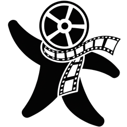

<p align="center">
  
</p>

<h1 align="center">Genra Canvas</h1>

<p align="center">
  Genra's node-based infinite canvas for AI image, video and text creation — <a href="https://canvas.genra.ai">canvas.genra.ai</a>
</p>

Genra Canvas is a fork of **[infinite-canvas](https://github.com/basketikun/infinite-canvas)** by [basketikun](https://github.com/basketikun) (MIT License), pinned to upstream `v0.20.0`. The canvas editor, node system, plugin SDK, prompt library and local IndexedDB persistence are upstream code; this fork wires the app to a Genra account instead of user-supplied API keys.

> 本项目基于 [basketikun/infinite-canvas](https://github.com/basketikun/infinite-canvas)（MIT 协议）二次开发。按上游作者的要求，保留原作者信息与页面标识（版本弹窗署名、GitHub 链接），[LICENSE](LICENSE) 原样保留。上游 README 见 [`docs/`](docs/) 与上游仓库。

## What this fork changes

| Area | Change |
|---|---|
| Sign-in | `web/src/services/genra/auth.ts`: supabase-js session shared with genra.ai through a `.genra.ai` cookie (same storage adapter as the Genra editor). Unauthenticated visitors are sent to the Genra login page. |
| Provider | `web/src/services/genra/channel.ts`: after sign-in a locked **Genra** channel is injected — `baseUrl = VITE_GENRA_API_URL + /openai`, `apiKey = the user's JWT`, models from `GET /openai/v1/models` grouped by `genra.capability`. The apiKey follows every token refresh. |
| Points | `web/src/services/genra/points.ts` + top bar badge reading `/api/v1/generate/points-balance`; click goes to Genra pricing. |
| Hidden UI | Provider / local proxy / WebDAV settings tabs, config import/export, the local Canvas Agent (Codex / Claude Code) panel and buttons. All behind switches in `web/src/services/genra/env.ts` (`VITE_GENRA_CHANNEL_LOCKED`, `VITE_GENRA_LOCAL_AGENT`). |
| Removed | `canvas-agent/`, `canvas-proxy/`, `plugins/infinite-canvas` (Codex app plugin), upstream GitHub workflows (Docker image, docs pages, plugin publishing). |
| Branding | Title / icon / antd theme colours; default locale `en-US` (zh-CN still available). |
| Deploy | `.github/workflows/deploy.yml` → Cloudflare Pages project `genra-canvas` on pushes to `production`. |

Hook points in upstream files are kept small so upstream can be merged: `stores/use-config-store.ts`, `components/layout/app-config-modal.tsx`, `components/layout/app-top-nav.tsx`, `components/canvas/canvas-top-bar.tsx`, `layouts/user-layout.tsx`, `components/layout/version-release-modal.tsx`, `hooks/use-version-check.ts`, `i18n/`, `main.tsx`, `index.html`, `lib/app-theme.ts`.

TODO (next iterations): "Add to Genra project" node action and a "Genra project assets" tab in the asset picker; cloud sync of canvases; main-site `/login` honouring the `redirect` parameter so users come straight back to the canvas.

## Local development

Requires [bun](https://bun.sh) and a Genra backend that exposes the OpenAI-compatible facade (`video_mvp` → `scripts/dev-backend.sh`, port 8000).

```bash
cd web
cp .env.example .env.local   # fill in VITE_SUPABASE_URL / VITE_SUPABASE_ANON_KEY
bun install
bun run dev                  # http://localhost:3000
```

`bun run typecheck` and `bun run build` must pass before opening a PR.

Sign-in for local development: the session cookie is host-only on `localhost`, so either sign in on a locally running Genra main site (`VITE_FRONTEND_URL=http://localhost:<port>`), or run the canvas on a `*.genra.ai` dev host so the production cookie is shared.

## Syncing with upstream

```bash
git fetch upstream --tags
git merge v0.21.0   # or the next upstream tag
```

Resolve conflicts in the hook-point files listed above; everything Genra-specific lives in `web/src/services/genra/`.

## License

[MIT](LICENSE) — copyright notice of the original author retained.
